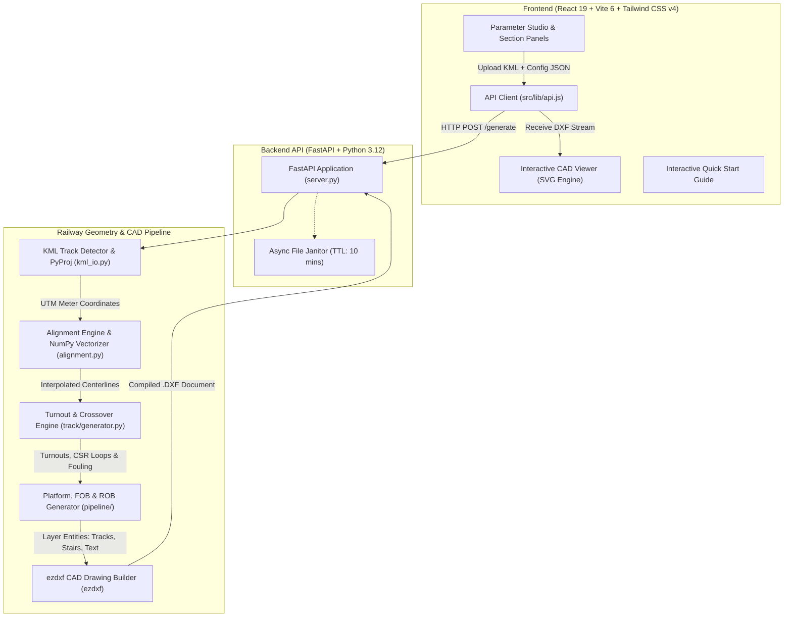

# Railway Engineering Scale Plan (ESP) Generator

An engineering-grade design studio and CAD drawing automation engine that transforms real-world **KML railway survey alignments** into standard **DXF Engineering Scale Plans (ESP)** compliant with Indian Railway engineering standards.

---

## Architecture Overview



---

## Key Features

- **Automated KML Survey Ingestion**:
  - Automatically parses 2D/3D `.kml` tracks from Google Earth, drone LiDAR, and GPS track logs.
  - Converts WGS84 geographic coordinates (latitude/longitude) to local metric planar coordinates via `pyproj`.
  - Intelligently detects track polylines, segment connectivity, and ranks continuous candidate paths by length.

- **Main Line & Multi-Tracking Support**:
  - One-click confirmation of the continuous **Main Line** corridor.
  - Multi-tracking support for additional continuous through tracks (e.g. 2nd/3rd Main Lines) with customizable running directions (`UP` / `DN`).

- **Railway Loops & CSR Sizing**:
  - Automatically generates running loops with standard track centers ($\ge 5.30\text{ m}$).
  - Computes Clear Standing Room (CSR) with automatic turnout lead offsets and overruns.
  - Compliant with Indian Railway turnout geometry (1 in 8.5 and 1 in 12 turnouts).

- **Passenger Platforms, FOBs & Infrastructure**:
  - **Platforms**: Generates single-faced side platforms and island platforms with standard clearances, end ramps, and staircases.
  - **Foot Over Bridges (FOB)**: Calculates cross-track bridge spans and descending platform staircases with configurable clearance and widths.
  - **Road Over Bridges (ROB)**: Spans full rail corridors with abutments and return wing walls.
  - **Fouling Points & Chainages**: Automatically plots fouling markers, station flags, gradient markers, and 100m chainage ticks.

- **CAD-Accurate Interactive Preview**:
  - Native SVG browser viewer rendering real-time CAD geometry with engineering red line strokes (`#ff0000`).
  - Pan (click & drag), zoom (wheel / $+/-$), and double-click to fit.
  - CAD layer filtering (Tracks, Turnouts, Platforms, Stations, FOBs, Signals, Text Labels).
  - Multi-format export: **AutoCAD DXF**, **High-Res PNG**, and **JSON configuration**.

- **Storage Janitor**:
  - Background asynchronous sweeper automatically purges generated temporary DXF files older than 10 minutes, keeping disk footprint lean on cloud deployments.

---

## Directory Structure

```text
esp_refactored/
├── backend/                        # Python FastAPI service & geometry engine
│   ├── cli/                        # Terminal CLI entry point and interactive wizard
│   ├── common/                     # Alignment geometry, math & constants
│   │   └── alignment.py            # Vectorized nearest-point projection (NumPy)
│   ├── config/                     # Pydantic schema validation & loader
│   ├── pipeline/                   # ESP orchestrator & entity builders
│   ├── platform_gen/               # KML reader, coordinate transforms & track detector
│   ├── track/                      # Turnout calculations, loops, and crossovers
│   ├── tests/                      # Pytest test suite (298 test cases)
│   └── server.py                   # FastAPI REST API with CORS & janitor
├── frontend/                       # React 19 + Vite 6 Single Page Application
│   ├── src/
│   │   ├── components/             # Parameter panels, DxfViewer & QuickGuideModal
│   │   ├── lib/                    # API client, DXF-to-SVG converter, config helpers
│   │   ├── App.jsx                 # Studio layout and workflow state
│   │   └── index.css               # Design tokens & color system
│   ├── .env.example                # Environment variable reference
│   └── package.json
├── data/                           # Sample railway alignment surveys (.kml)
├── examples/                       # Sample input configurations (.json)
├── output/                         # Temporary generated CAD drawings (.dxf)
├── pyproject.toml                  # Python package configuration & dependencies
├── requirements.txt                # Exact Python dependencies
└── README.md
```

---

## Getting Started

### Prerequisites
- **Python**: `>= 3.10` (Python 3.12 recommended)
- **Node.js**: `>= 18.0` (Node 20+ recommended)
- **Package Managers**: `pip` and `npm`

---

### 1. Backend Setup

1. **Create and activate a virtual environment**:
   ```bash
   python -m venv venv

   # On Windows:
   venv\Scripts\activate

   # On Linux/macOS:
   source venv/bin/activate
   ```

2. **Install dependencies and register backend modules**:
   ```bash
   pip install -r requirements.txt
   pip install -e .
   ```

3. **Start the FastAPI backend server**:
   ```bash
   # From the project root:
   uvicorn backend.server:app --host 127.0.0.1 --port 8000 --reload
   ```
   *The API will be live at `http://127.0.0.1:8000` (docs available at `/docs`).*

4. **Run backend unit tests**:
   ```bash
   pytest backend
   ```

---

### 2. Frontend Setup

1. **Navigate to the frontend directory**:
   ```bash
   cd frontend
   ```

2. **Install Node dependencies**:
   ```bash
   npm install
   ```

3. **Configure environment variables**:
   Create a `.env` file in the `frontend` folder:
   ```env
   VITE_API_BASE=http://127.0.0.1:8000
   ```

4. **Start the development server**:
   ```bash
   npm run dev
   ```
   *Open your browser at `http://localhost:5173`.*

5. **Run frontend unit tests & build check**:
   ```bash
   npm test -- --run
   npm run build
   ```

---

## Production Deployment Guide

### Backend (Render.com)

1. Create a **New Web Service** pointing to your repository.
2. Configure settings:
   - **Environment**: `Python`
   - **Build Command**:
     ```bash
     pip install -r requirements.txt && pip install -e .
     ```
   - **Start Command**:
     ```bash
     uvicorn backend.server:app --host 0.0.0.0 --port $PORT
     ```
   - **Health Check Path**: `/health`

---

### Frontend (Netlify / Vercel)

1. Connect your GitHub repository to Netlify.
2. Configure build settings:
   - **Base directory**: `frontend`
   - **Build command**: `npm run build`
   - **Publish directory**: `frontend/dist`
3. Add Environment Variable:
   - **Key**: `VITE_API_BASE`
   - **Value**: `https://<your-backend-app>.onrender.com`

---

## API Endpoints Reference

| Method | Endpoint | Description |
| :--- | :--- | :--- |
| `GET` / `HEAD` | `/health` | Zero-overhead health check route for load balancers and uptime monitors |
| `POST` | `/detect-tracks` | Scans uploaded KML survey and returns sorted candidate track paths |
| `POST` | `/main-center` | Computes track centerline midpoint and default 750m loop bounds |
| `POST` | `/generate` | Accepts `inputconfig.json` + `track.kml` multipart upload and streams the finished DXF |
| `POST` | `/convert-kml-direct`| Direct 1:1 conversion of KML polylines into North-up geographic CAD DXF |

---

## CAD Drafting Standards

- **Units**: Metric (1 drawing unit = 1.0 meter).
- **Primary Track Color**: Engineering CAD Red (`#ff0000`).
- **Layers**:
  - `MAIN_LINE`: Through track alignment with station flags and chainage markers.
  - `LOOP_X`: Passenger/goods loop tracks.
  - `TURNOUT`: 1:8.5 and 1:12 crossover turnouts and switch points.
  - `PLATFORM_X`: Passenger platforms with staircases and copings.
  - `FOB_X`: Foot overbridge decks and platform staircases.
  - `SRJ_FOULING`: Stock Rail Joint and fouling point safety markers.
  - `CHAINAGE_ANNOTATIONS`: 100m interval chainage tick marks and text.

